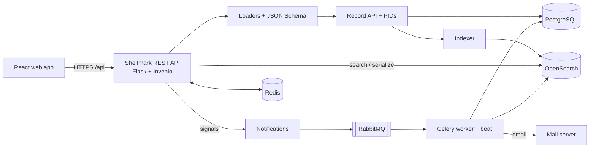

# Shelfmark

Shelfmark is the backend of an integrated library system (ILS): a REST API, built on the
Invenio framework, that manages a library's catalogue, loans, acquisitions and
interlibrary loans.

## What This Project Does

Running a library means keeping track of what the library owns, where each copy is, who
has borrowed it and what still has to be bought or borrowed from elsewhere. Shelfmark
stores all of this as searchable JSON records and exposes it through a REST API, which
a separate single-page web app uses for both the public catalogue and the librarian
back office.

It is for libraries that want a self-hosted, open-source ILS, and for developers who
want to study or extend one.

Main features:

- **Catalogue**: documents (books, articles, proceedings and so on), series, physical
  items, electronic items (e-items) with downloadable files, and relations between
  records (editions, languages, multipart monographs, serials).
- **Circulation**: loan requests, checkout, self-checkout, extensions, bulk extension,
  returns and cancellations, with rules for loan periods, renewals and overdue loans.
- **Locations**: libraries, internal locations (shelves and rooms), opening hours and
  closure periods that are taken into account when loan dates are calculated.
- **Patrons**: loan information per patron, activity history and anonymisation.
- **Document requests**: patrons suggest new literature, and librarians accept or
  decline the request.
- **Acquisition**: purchase orders and order lines with vendors and budgets.
- **Interlibrary loans (ILL)**: borrowing requests to other libraries, with their own
  loan and extension workflow.
- **Notifications**: emails for loan events, plus daily reminders for loans that are
  about to expire or are overdue, with a log of sent notifications.
- **Search and statistics**: full-text search with facets, CSV export, most-loaned
  documents, histograms for loans, orders and requests, and record-view and download
  counts.
- **Permissions**: roles for admins, librarians, read-only librarians and patrons.
- **Vocabularies**: languages, countries, licenses and other controlled lists, loaded
  from the command line.

## How It Works

Shelfmark is a set of Invenio modules. Every library concept (document, item, loan,
order and so on) follows the same pattern:

1. A **JSON Schema** (`schemas/`) defines what a valid record looks like.
2. A **loader** (`loaders/`) validates the incoming JSON from an API request.
3. The **API class** (`api.py`) creates or updates the record in **PostgreSQL** and mints
   a persistent identifier (PID) for it.
4. An **indexer** sends the record to **OpenSearch** using the module's mapping
   (`mappings/`). JSON resolvers expand references (for example, an item's document),
   so the indexed record is complete.
5. **Search classes** (`search.py`) and **permissions** filter what each user can see.
   **Serializers** (`serializers/`) return the result as JSON or CSV.

Circulation actions (`/circulation/loans/request`, `/circulation/loans/checkout` and so on)
go through the loan state machine provided by `invenio-circulation`. Shelfmark adds its
own rules for loan periods, item availability and library closures. Each state change
fires a signal. The notifications module turns signals into emails, which are sent by a
**Celery** worker through **RabbitMQ**. Celery beat runs the scheduled jobs: reminders,
cancelling expired requests, and indexing and statistics aggregation. **Redis** stores
sessions, the cache, rate limits and Celery results.



## Project Structure

```text
shelfmark/
├── shelfmark/                  # The Python package
│   ├── ext.py                  # Flask extensions that register the ILS REST and UI apps
│   ├── config.py               # Default settings: REST endpoints, search facets, Celery schedule, mail
│   ├── permissions.py          # Role-based access rules for every action
│   ├── records/                # Base record API, metadata extensions and shared serializers
│   ├── documents/              # Documents: schema, mappings, loaders, resolvers, search, serializers
│   ├── items/                  # Physical copies of documents, with barcodes and statuses
│   ├── eitems/                 # Electronic items and their downloadable files
│   ├── series/                 # Serials and multipart monographs
│   ├── literature/             # Combined search over documents and series
│   ├── relations/              # Relation types (edition, language, sequence, ...)
│   ├── records_relations/      # API for creating and deleting relations between records
│   ├── circulation/            # Loans: actions, rules, availability, notifications, stats
│   ├── locations/              # Libraries and their opening hours
│   ├── internal_locations/     # Shelves and rooms inside a location
│   ├── closures/               # Closure periods used when calculating loan dates
│   ├── patrons/                # Patron records, loan information, anonymisation CLI
│   ├── document_requests/      # Requests for new literature
│   ├── acquisition/            # Purchase orders and order lines
│   ├── ill/                    # Interlibrary borrowing requests
│   ├── providers/              # Vendors and partner libraries
│   ├── notifications/          # Email backend, message builders and notification log model
│   ├── stats/                  # Event and aggregation templates for usage statistics
│   ├── files/                  # File upload endpoints for e-items
│   ├── vocabularies/           # Controlled vocabularies and their CLI
│   ├── templates/              # Jinja templates for emails and pages
│   └── assets/                 # Theme files for the web assets build
├── tests/                      # Pytest suite: conftest fixtures, test data and API tests per module
├── docker-compose.yml          # Services for local development (PostgreSQL, Redis, RabbitMQ, OpenSearch)
├── docker-services.yml         # Shared service definitions used by both compose files
├── pyproject.toml              # Package metadata, dependencies and entry points
└── .env.example                # Example environment variables
```

Each record module (for example `documents/`) has the same layout: `api.py`,
`schemas/`, `mappings/` (`v7` for Elasticsearch 7, `os-v1` and `os-v2` for OpenSearch),
`loaders/`, `jsonresolvers/`, `search.py`, `serializers/` and `indexer.py`.

## Tech Stack

| Layer | Technology | Purpose |
|---|---|---|
| Language | Python ≥ 3.9 (Docker image: 3.14) | Application code |
| Web framework | Flask via Invenio (`invenio-app` 3.x, `invenio-base` ≥ 2.3.2) | App factory, CLI and request handling |
| REST API | `invenio-records-rest` 4.x, `invenio-rest` 3.x | CRUD and search endpoints for every record type |
| Records | `invenio-records` 4.x, `invenio-pidstore` 3.x, `jsonschema` ≥ 4.24 | JSON records, persistent identifiers and validation |
| Circulation | `invenio-circulation` 4.x | Loan state machine |
| Database | PostgreSQL 14, `invenio-db` 2.x, `alembic` ≥ 1.16.4 | Record storage and migrations |
| Search | OpenSearch (Docker: 3.2.0), `invenio-search[opensearch2]` ≥ 3.1.0, `invenio-indexer` 4.x | Indexing and full-text search |
| Background jobs | Celery via `invenio-celery` ≥ 2.2.0, RabbitMQ 3 | Notifications, reminders, indexing, statistics |
| Cache and sessions | Redis 6, `invenio-cache` 3.x | Cache, sessions, rate limits, Celery results |
| Auth | `invenio-accounts` 7.x, `invenio-access` 5.x, `invenio-oauthclient` 7.x, `invenio-oauth2server` 4.x | Users, roles, OAuth login and API tokens |
| Files | `invenio-files-rest` 4.x | E-item file storage |
| Statistics | `invenio-stats` 6.x | Record views, downloads, loan transitions |
| Other Invenio modules | `invenio-oaiserver` 4.x, `invenio-pages` 8.x, `invenio-mail` 2.x, `invenio-i18n` 3.x | OAI-PMH harvesting, static pages, email, translations |
| Testing | `pytest-invenio` ≥ 3.4.2, `pytest-mock`, `docker-services-cli` ≥ 0.6.0 | Test fixtures and temporary services |
| Packaging | Hatchling | Builds the package from `pyproject.toml` |

## How to Run This Project

The application is still being assembled. These steps prepare a development
environment.

### 1. Prerequisites

- Python 3.9 or newer
- Docker and Docker Compose

### 2. Clone

```bash
git clone https://github.com/hadeeddev921/shelfmark.git
cd shelfmark
```

### 3. Install dependencies

```bash
python -m venv .venv
source .venv/bin/activate
pip install -e ".[opensearch2]"
```

### 4. Environment variables

Every setting in `shelfmark/config.py` can be overridden with an environment variable
prefixed with `INVENIO_`. Copy the example file and load it into your shell:

```bash
cp .env.example .env
set -a; source .env; set +a
```

See `.env.example` for the database, Redis, RabbitMQ and OpenSearch settings.

### 5. Start the services

```bash
docker compose up -d
```

This starts PostgreSQL, Redis, RabbitMQ, OpenSearch and OpenSearch Dashboards.
